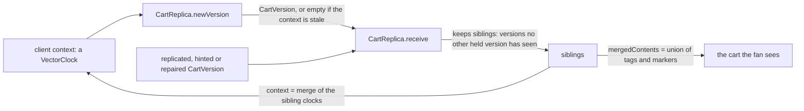

# Architecture of seatwave-clocks

A deterministic model of how SeatWave's cart store orders and merges writes without trusting wall clocks: three kinds of clock, a cart that keeps concurrent versions and merges them, and two counters that converge. It needs only the JDK; the libraries in the build are for the tests and the formatter.

## Packages

One package, `io.plainround.seatwave.clocks`. Every type is an immutable record or a final class.

| Type | Role |
|---|---|
| `LamportClock` | one counter per node; `tick`, `receive` (past both counters); `TOTAL_ORDER` by counter then node id, invented for concurrent events |
| `HybridTimestamp` | the largest wall-clock reading heard of plus a logical counter; `tick` and `receive` take the wall clock as an argument, so a skewed or stepped clock can be tested |
| `VectorClock` | one counter per replica; `increment`, `merge`, `compareTo` (BEFORE, AFTER, CONCURRENT, EQUAL), `dominates` |
| `CartContents` | the cart as an observed-remove set: unique add tags per seat, removal markers; `add`, `remove`, `merge`, `seats()` |
| `CartVersion` | key, vector clock, contents, the writer's wall-clock stamp (read only by the last-writer-wins design) |
| `CartReplica` | the siblings of one key; `newVersion` builds a version from a client's context, `receive` is the only way a version enters |
| `GrowOnlyCounter`, `PositiveNegativeCounter` | state-based counters; merge takes the larger tally per replica |
| `ClockSkewCli`, `OrderingCli`, `CartConflictCli`, `CounterCli` | the only code that prints |

Dependency rule: `*Cli` -> `CartReplica` -> `CartVersion` -> (`VectorClock`, `CartContents`); the clocks and counters depend on nothing. Nothing below a `*Cli` prints, exits or reads the machine's clock.

## Data flow

## Walk-throughs

A write: the client reads, gets the siblings' merged contents and a context (the merge of their clocks), changes the cart and sends both back. `newVersion` makes the clock `context + 1` for this replica and `receive` stores it, dropping every version it has seen. A client that did not see this replica's own latest write is refused, because one counter per replica cannot tell the two writes apart.

A conflict: two replicas write on top of the same version. Their clocks are concurrent, so each replica keeps both siblings; the next read returns both and the merged contents (union of add tags and of removal markers), and the next write carries the merged context, which replaces both siblings.

## Decisions and trade-offs

- Vector clocks decide order, not wall clocks: wall-clock last-writer-wins is shown dropping 449 of 1,000 causally later writes at 200 ms skew (`ClockSkewCli`). The cost is one counter per writing replica in every version.
- The cart is an observed-remove set: a removal cancels only the adds it saw, so a concurrent add survives. The cost is tags and markers that grow until a cleanup rule removes them (described in the module, not coded).
- `newVersion` fails safe with an empty result on a stale context. Dotted version vectors would remove the refusal at the price of more metadata.
- Every time source is an argument, so the programs and tests never read this machine's clock.

## Invariants and where they are enforced

| Invariant | Enforced by | Tested by |
|---|---|---|
| Replicas that saw the same updates hold the same siblings and counters, in any order and with repeats | `CartReplica.receive`, the merges | `ConvergenceTest` |
| A version already seen is ignored; a version another has seen is dropped | `CartReplica.receive` | `CartReplicaTest`, `ConvergenceTest` |
| A new version never claims to have seen a write it has not | `CartReplica.newVersion` | `CartReplicaTest` |
| Concurrent clocks are reported as concurrent | `VectorClock.compareTo` | `VectorClockTest` |
| A Lamport receive is past both counters; a hybrid timestamp never goes backward and never runs ahead of the largest reading | `LamportClock.receive`, `HybridTimestamp` | `LamportClockTest`, `HybridTimestampTest` |
| A removal cancels only the adds it saw | `CartContents.remove`, `seats()` | `CartContentsTest`, `ConvergenceTest` |
| A grow-only counter only grows and merges by the larger tally | `GrowOnlyCounter` | `CounterValidationTest`, `ConvergenceTest` |
| An invalid value cannot exist (blank ids, counters below 1, malformed seat labels, blank tags, negative parts) | compact constructors | each type's test |
